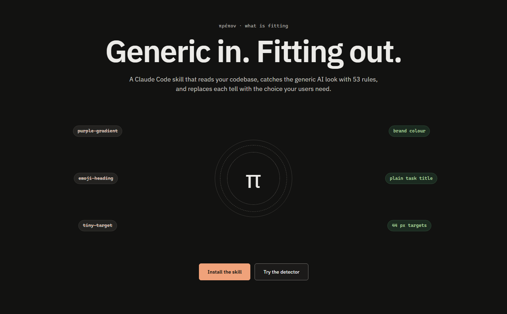
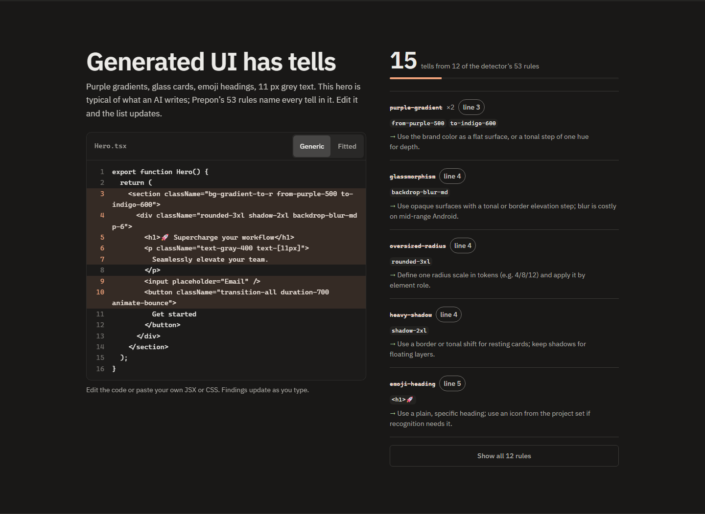
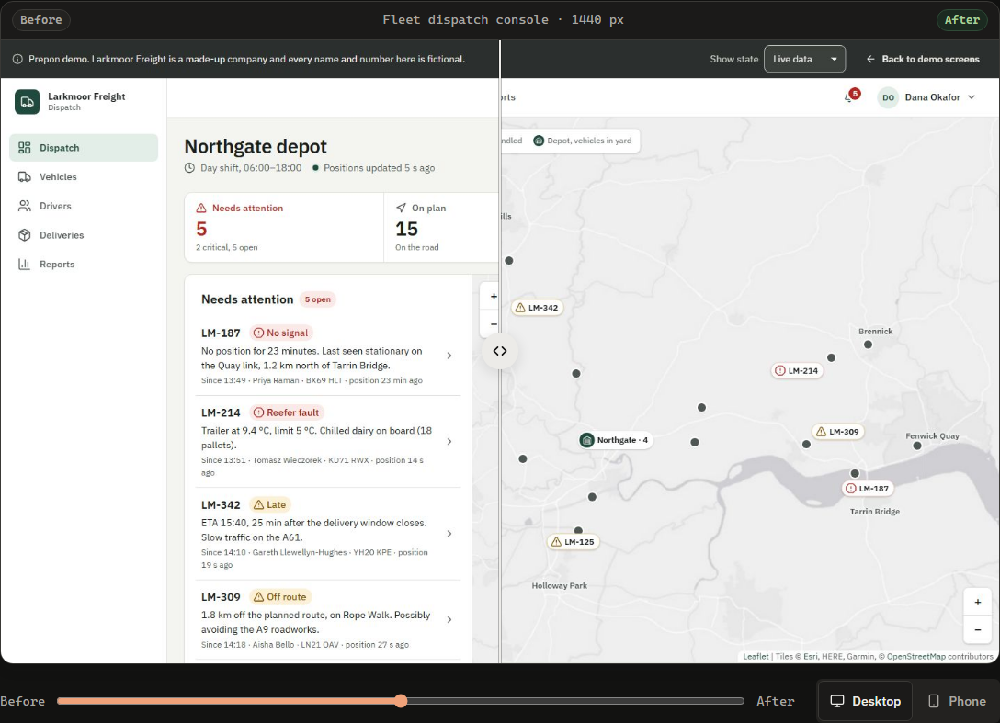

<p align="center"></p>

<h1 align="center">Prepon</h1>

<p align="center"><strong>Generic in. Fitting out.</strong></p>

<p align="center">
  A Claude Code skill for UI work on enterprise products: government portals, banking apps,<br>
  operations dashboards, form-heavy workflows, and their mobile apps.
</p>

<p align="center">
  <a href="#install">Install</a> ·
  <a href="#what-you-get">What you get</a> ·
  <a href="#commands">Commands</a> ·
  <a href="#the-scripts">Scripts</a> ·
  <a href="#privacy-and-side-effects">Privacy</a> ·
  <a href="#develop">Develop</a>
</p>



---

## Why

Ask an AI for a screen and you get the same screen everyone gets: a purple gradient, Inter, three icon cards, grey helper text, "Seamlessly elevate your workflow." It isn't wrong in general. It's wrong for *this* product and *these* users, and in government and banking, looking generic reads as looking unsafe.

- **The project decides, not the default.** Prepon reads the codebase first (tokens, components, domain, who signs in, what phone they're on) and designs from that.
- **Every decision says why.** A rationale table names the principle behind each choice, or says plainly that it was a judgment call. Clients can trust it because it doesn't name-drop.
- **The generic look gets caught.** A detector with 53 rules flags the mechanical tells, from purple gradients to "Oops! Something went wrong", and each one comes with what to do instead.

## Install

```sh
claude plugin marketplace add PatriusCastro/prepon
claude plugin install prepon@prepon
```

Then ask for UI work as usual ("audit the permit application form"), or call it directly: `/prepon:prepon audit src/pages/PermitApplication.tsx`. While the repo is private, your git credentials need read access to it.

Other ways to load it:

```sh
claude plugin marketplace add /path/to/prepon          # from a local clone, then install as above
claude --plugin-dir /path/to/prepon/plugins/prepon     # one session only, without installing
```

After editing skill files, run `/reload-plugins` in the session.

### Requirements

- **Claude Code**, a recent version: tested on 2.1.322, and the manifest validates on 2.1.325. Canvas mode's design canvas needs v2.1.265 or later, a claude.ai login, and an organization that hasn't turned off the Design template.
- **Node.js 18 or later** for the bundled scripts. They have no dependencies.
- **Playwright (optional)** in the project you're working on, for screenshots and the rendered-page checks. Prepon uses the project's own install and asks before adding it.
- **Artifacts (optional)** for publishing audit report pages, before/after comparisons, and canvas directions. They need a claude.ai login and aren't available on Bedrock, Vertex, or Foundry, or with `claude -p`. Without them, Prepon writes local files and gives a change summary table.

## What you get

### UI that fits the project

Before designing anything, Prepon reads the project: README, routes, UI copy, design tokens, component library, and what the existing screens actually use (`scan-consistency.js` counts every radius, colour, and button variant). It matches the project to a type (government, banking, operations, forms) and its audience, summarises what it found, and asks only about what's still unknown. New UI extends the existing tokens instead of replacing them with its own taste, and it's built mobile-first at 360 px.

### Principles, cited honestly

Every build ends with a table: decision, principle, why it applies here. The references cover UX laws, Nielsen's ten heuristics, WCAG 2.2 AA, Apple and Android platform values, and UX writing, each with sources. A principle is cited only when it drove the decision; "Judgment call: matches the existing card style" is a valid entry.

### The generic look, caught



53 rules across visuals (`purple-gradient`, `glassmorphism`, `side-stripe`), motion (`transition-all`, `layout-animation`), accessibility (`tiny-target`, `placeholder-label`), and generated copy (`ai-vocabulary`, `vague-error`, `vague-link`). Each finding pairs the tell with the alternative, because banning a default without replacing it only moves the output to the next default. The judgment tells no regex can catch (identical card grids, the SaaS landing skeleton, lists of three everywhere) are a checklist the skill reviews itself.

### Before and after, seen



When Prepon changes an existing screen, it captures it at 360, 768, and 1440 px before and after and publishes a side-by-side comparison. It also checks the rendered page: sideways overflow, clipped text, what users see first (a blurred "squint test" and a tap map), and whether motion holds its frame rate on a slow phone. It never describes a screenshot it didn't take.

### Consistency, fixed at the source

Mismatched radii, border colours, button variants and states, and wording are found across screens and fixed in the token or the shared component, not patched screen by screen.

## Commands

Plugin skills are namespaced, so the full command is `/prepon:prepon`. The bare `/prepon` also works as long as nothing else claims that name. You can also skip the command: Prepon triggers on its own when you ask for UI work, and infers the mode.

| Mode | What it does | Example |
|---|---|---|
| `build` | Creates or changes UI, mobile-first, with a slop scan, an accessibility checklist, before/after screenshots for existing screens, and a rationale table. | `/prepon:prepon build a vehicle detail drawer for the dispatch console` |
| `audit <target>` | Reviews existing UI, writes `docs/ui-audit-YYYY-MM-DD.md`, and publishes a report page with charts. Never edits code. | `/prepon:prepon audit src/pages/PermitApplication.tsx` |
| `fix` | Applies findings from the latest audit in severity order, with before/after. | `/prepon:prepon fix A1-A3` |
| `cite <target>` | Explains an existing design: decision, principle, why it applies, and status. Outputs a paste-ready Markdown table. Never edits code. | `/prepon:prepon cite the transfer review screen` |
| `refs <pattern>` | Finds 3 to 5 real, well-regarded examples with links and what to adapt. Structure only, no copying. | `/prepon:prepon refs multi-step identity verification` |
| `canvas <brief>` | Writes a design brief, publishes three directions as artboards on a design canvas (or an HTML preview as a fallback), reviews each one, then builds the one you pick. | `/prepon:prepon canvas mobile banking settings screen` |

### What an audit looks like

A shortened example for a made-up demo screen:

```markdown
# UI audit: Dispatch console (demo)

Date: 2026-11-12 · Project type: Operations dashboard · Platform: web · Method: code and screenshots

## Summary
The console shows 40 vehicles well on desktop, but alerts use the same red as the brand accent, so
real exceptions don't stand out. On phones the table overflows and the action buttons are 28px.

| Area | Score | Reason |
|---|---|---|
| Usability | 6/10 | Filters work, but there's no default "needs attention" view. |
| Accessibility | 5/10 | Status is color-only; muted text is 2.5:1. |
| Responsiveness and mobile | 4/10 | The table forces horizontal page scroll at 360px. |
| Distinctiveness | 6/10 | Four identical KPI cards with sparklines; the rest is specific. |
| Consistency | 5/10 | Three button variants for one primary action; radius is md everywhere except two drawers. |
| **Total** | **26/50** | |

## Findings
| ID | Severity | Location | Finding | Principle or rule | Suggested fix |
|---|---|---|---|---|---|
| A1 | critical | src/components/StatusPill.tsx:12 | Status shown by color alone | WCAG 1.4.1 | Add a text label and an icon |
| A2 | major | src/pages/Dispatch.tsx:88 | Alert red equals brand red | Von Restorff | Reserve a separate alert token |
| A3 | major | src/pages/Dispatch.tsx:140 | Row actions are 28px | WCAG 2.5.8; Android 48dp | min-h-12 hit area |

## Prioritized fix list
1. A1: blocks color-blind dispatchers from seeing faults.
2. A3: drivers' supervisors use this on phones.
3. A2: …
```

## The scripts

All scripts live in `plugins/prepon/skills/prepon/scripts/`, need only Node, and print JSON. The skill runs them for you; you can also run them yourself.

| Script | What it checks | Needs |
|---|---|---|
| `detect-slop.js` | The 53 mechanical tells in `.js`, `.jsx`, `.ts`, `.tsx`, `.css`, `.scss`, and `.html` | Source files |
| `scan-consistency.js` | Every radius, border, colour, shadow, type size, and button variant in use, with outliers against the project's own norm | Source files |
| `check-page.js` | Sideways overflow, clipped or covered text, content still hidden after load, long lines, load errors | Dev server, Playwright |
| `tap-map.js` | Thumb zones, a blurred squint test, and the predicted order people look at the first screen | Dev server, Playwright |
| `motion-perf.js` | Dropped and long frames with the CPU slowed 4–6×, animations off the compositor or off screen | Dev server, Playwright (Chromium) |
| `snapshot.js` | Before/after screenshots at 360, 768, and 1440 px | Dev server, Playwright |

### The slop detector

```sh
node plugins/prepon/skills/prepon/scripts/detect-slop.js src/
```

```json
[{ "rule": "gradient-text", "file": "src/Hero.tsx", "line": 6, "match": "bg-clip-text", "suggestion": "Use solid ink or brand color; …" }]
```

It exits with 1 when it finds anything. To keep a deliberate choice, add `// prepon-ignore <rule-id>` (in JSX: `{/* prepon-ignore <rule-id> */}`) on the line or the line above. A file that quotes slop on purpose, like a docs page, can carry `prepon-ignore-file <rule-id>,...` once instead. With no rule ids, either form ignores all rules.

### The optional slop hook

The plugin ships a hook that runs the detector on every UI file Claude edits and reports findings straight back, so they get fixed while the work is happening. It stays silent until you turn it on:

- **Every project:** turn on *Slop check after every UI edit* under the plugin's settings in `/config`.
- **One project:** create `.prepon/hook-on` in the project root (`.prepon/` is git-ignored). Delete it to turn the hook off.
- **One shell:** set `PREPON_HOOK=1`.

Claude Code asks you to approve plugin hooks before they run.

### The page, motion, and consistency checks

```sh
node plugins/prepon/skills/prepon/scripts/check-page.js --base http://localhost:5173 --routes /,/settings [--reduced-motion]
node plugins/prepon/skills/prepon/scripts/motion-perf.js --base http://localhost:5173 --routes /,/settings --cpu 4
node plugins/prepon/skills/prepon/scripts/scan-consistency.js --summary src/
```

- **`check-page.js`** loads each route at 360 and 1440 px in the project's Playwright and scrolls through it, reporting what only a rendered page shows.
- **`motion-perf.js`** traces 3 s of idle and a scroll at 360 px with the CPU slowed (`--cpu 4` is roughly a mid-range phone, `--cpu 6` a low-end one). Dropped frames come from the browser's own frame reporting, not a JavaScript counter, which would add the very main-thread work it measures. The throttling is an emulation, so compare runs on one machine rather than treating the numbers as a specific phone's. Audit lists what it finds as findings or as opportunities (O1, O2…) that don't change the score; `fix O1-O3` applies named ones and re-runs it.
- **`scan-consistency.js`** never flags token references (`var(--x)`); when tokens are the norm, raw literals are the outliers. It also groups buttons by style, lists buttons missing states most others have (hover, focus-visible, disabled, pressed), and finds raw `<button>` elements that bypass an existing `Button` component. To track another property, add an object to the `PROPERTIES` array at the top of the script.

## Privacy and side effects

- **What it reads:** your project's source files, configuration, and docs, through Claude Code's normal tools.
- **What it writes:** UI code (in `build` and `fix`), audit reports to `docs/ui-audit-YYYY-MM-DD.md`, and screenshots, tap maps, and canvas fallbacks to `.prepon/` in your project (or to a folder you choose with `--out`). It checks that `.prepon/` is in `.gitignore` before writing there, because screenshots of client screens don't belong in version control. `audit`, `cite`, and `refs` never edit code.
- **What leaves your machine, beyond the conversation itself:**
  - **Artifacts.** Audit report pages, before/after comparisons (with their screenshots), and canvas directions are published as claude.ai Artifacts, which are private to you until you share them. Without Artifacts, they stay as local files.
  - **Web search** in `refs` mode, for the UI pattern you name.
- **What it runs:** the bundled Node scripts, and your project's own Playwright, pointed at the dev server URL you give it. The skill pre-approves only `node <scripts>/*`; any other command goes through your normal permission prompts. It asks before installing Playwright. The scripts make no network requests of their own beyond loading those pages (and whatever those pages load).
- **The hook** is off until you turn it on (see above), reads only the file that was just edited, and writes nothing.

## Develop

```sh
node --test test/*.test.js                 # the scripts' self-tests (the page and motion tests use site/'s Playwright)
claude plugin validate .                   # the marketplace manifest
claude plugin validate plugins/prepon      # the plugin: manifest, icon, settings, license
```

CI runs the tests, a build of the docs site, and both validations on every push and pull request, pinned to one Claude Code version (`.github/workflows/ci.yml`). A weekly run validates against the newest Claude Code, so a change to the plugin format shows up before users hit it (`latest-engine.yml`). On Windows, pass the test files explicitly as above: `node --test test/` fails there.

The docs and showcase site lives in `site/` (Vite + React): `npm install --prefix site`, then `npm run dev --prefix site`. Its live detector imports the rules straight from `detect-slop.js`, so the two can't drift.

### Adding a slop rule

1. Add an object to the `RULES` array at the top of `detect-slop.js`:
   ```js
   {
     id: 'neon-glow',
     pattern: /\bshadow-\[0_0_\d+px_[^\]]*\]/g,   // global regex, runs over the whole file
     exts: ['jsx', 'tsx'],                        // optional
     when: /…/, unless: /…/,                      // optional filters on the matched text
     suggestion: 'Use elevation tokens; glows read as decoration.',
   },
   ```
2. Add a matching `### neon-glow` entry under "Mechanical tells" in `references/slop-patterns.md`, with the tell and what to do instead. A rule without an alternative just moves the output to the next default.
3. Add a snippet that triggers it to `test/detect-slop.test.js` and run the tests. The first test fails if any rule never fires.

### Repo layout

```
.claude-plugin/marketplace.json      marketplace "prepon"
plugins/prepon/.claude-plugin/       plugin.json (manifest and settings) and icon.png
plugins/prepon/skills/prepon/
  SKILL.md                           router and core workflow
  references/                        ux-laws, ux-writing, slop-patterns, hierarchy, visual-craft, consistency, icons, motion, responsive, mobile, accessibility, project-types, modes, before-after
  scripts/                           detect-slop, scan-consistency, check-page, tap-map, motion-perf, snapshot, hook-slop
plugins/prepon/hooks/hooks.json      wires the optional hook
test/                                self-tests for the scripts (not shipped in the plugin)
site/                                docs and showcase site
assets/readme/                       images for this README
.github/workflows/                   CI and the weekly latest-Claude-Code check
```

Outputs from real projects (`.prepon/` snapshots and `docs/ui-audit-*.md`) belong in those projects, not in this repo.

## The name

*Prepon* (πρέπον) is the Greek rhetorical term for what is fitting: matching form to audience, purpose, and occasion. It's the skill's central test. For every decision, the question isn't "is this good in general?" but "is this fitting for this project and these users?"

## License

[MIT](LICENSE) © 2026 Pat Castro.
